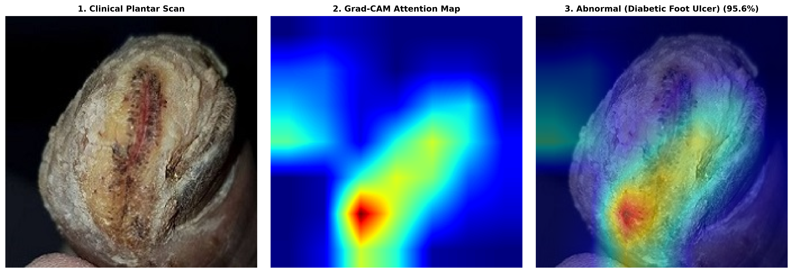

# Explainable Diabetic Foot Ulcer (DFU) Detection Pipeline

**PhD Research Portfolio — Practical 3:** An end-to-end, hospital-grade medical computer vision pipeline for early-stage Diabetic Foot Ulcer (DFU) detection using **EfficientNet-V2-S**, **Focal Loss**, and **Grad-CAM** spatial explainability.

---

## Clinical Motivation & Architecture

Early detection of superficial tissue breakdown and localized erythema prevents severe lower-limb complications in diabetic patients. This repository implements a modular classification and visual verification system:

1. **Photometric-Safe Preprocessing (`src/dataset.py`):** Resizes plantar skin images to $224 \times 224$ and applies geometric augmentations while restricting hue shifts ($\le 0.03$) to preserve critical diagnostic erythema and ischemia color cues.
2. **Backbone & Focal Loss (`src/model.py`):** Fine-tunes an **EfficientNet-V2-S** backbone paired with a regularized classification head and class-weighted **Focal Loss** ($\gamma = 2.0$) to focus gradient updates on subtle, ambiguous ulcer margins.
3. **Leakage-Guarded Training (`train.py`):** Uses Stratified K-Fold splitting (with native `StratifiedGroupKFold` support when patient IDs are available), AdamW optimization, and Cosine Annealing LR scheduling.
4. **Spatial Explainability (`src/explainability.py`, `visualize_dfu_cam.py`):** Extracts Grad-CAM activation maps from the final convolutional block (`features[-1]`) to produce 3-panel clinical verification figures (`assets/dfu_gradcam_report.png`).

---

## Visual Explainability Output



*(Left: Clinical plantar scan | Center: Grad-CAM spatial attention map | Right: Blended diagnostic overlay)*

---

## Validation Benchmarks

Evaluated on the 5-fold stratified validation split (1,055 plantar skin scans):

| Metric | Score |
| :--- | :--- |
| **ROC-AUC** | **0.9956** |
| **Macro F1-Score** | **0.9763** |

---

## Repository Structure

```text
diabetic_dfu_pipeline_task3/
├── assets/
│   └── dfu_gradcam_report.png   # 3-panel clinical Grad-CAM verification figure
├── data/
│   └── dfuc_metadata.csv        # Standardized image-to-label manifest
├── src/
│   ├── __init__.py
│   ├── dataset.py               # Clinical transforms & PyTorch Dataset
│   ├── explainability.py        # Grad-CAM forward/backward hook engine
│   └── model.py                 # EfficientNet-V2-S classifier & Focal Loss
├── tests/
│   └── test_dfu_pipeline.py     # Automated unit tests (pytest)
├── evaluate_clinical.py         # Sensitivity, Specificity & Confusion Matrix audit
├── prepare_kaggle.py            # Dataset folder-to-CSV formatter
├── train.py                     # Model training & checkpointing script
├── visualize_dfu_cam.py         # 3-panel Grad-CAM figure generator
└── requirements.txt
```

## Quick Start
### Install dependencies:

Bash

pip install -r requirements.txt

### Run automated unit tests:

Bash

python -m pytest tests/test_dfu_pipeline.py

### Train model & generate Grad-CAM report:

Bash

python train.py

python visualize_dfu_cam.py

python evaluate_clinical.py
